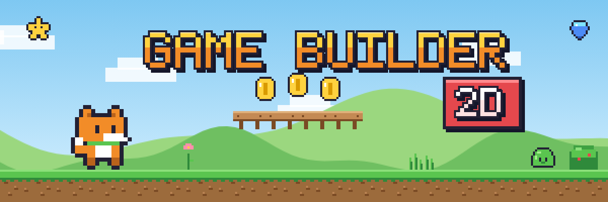

<p align="center"></p>

# Game Builder 2D

**English** · [Svenska](#svenska)

A browser tool where students make their own games without writing code. They pick or draw pictures, give them **behavior cards** (Player, Patrol, Collectible, Hurts on touch …), add **rules** like *"When the player touches the door → go to the next level"*, and export a finished game as a single HTML file.

Made by **DorkTeach**.

## Features

- Four game types: **platformer**, **top-down**, **arcade** (one screen) and **3D first-person** (walk inside a top-down map)
- **27 behavior cards**, including Quiz question, Spawner, Shooter, Teleporter, Talk, Path (moving platforms) and Pushable
- **Rules editor** with 10 triggers and 19 actions, own variables and conditions, in three builder levels (cards only → rules → variables)
- **Drawing tool**: 16×16 or 32×32 pixel art, up to 4 animation frames, picture import, own tiles
- **161 built-in pictures**, 34 tiles, 18 backgrounds and 6 generated music loops
- Story screens, quiz questions and choice dialogues for **learning games**
- Record or upload **own sounds**
- **Two players** on one keyboard and gamepad support
- **Teacher tools**: challenges with a checklist, PIN-locked builder level, reflection questions on export
- **Accessibility**: one-button mode, switch scanning, dwell buttons (eye tracking), game speed, unlimited lives, large buttons, read-aloud, easy-read font
- Swedish and English
- Exported games work offline, on GitHub Pages and embedded on Google Sites. Exported games can be opened again in the editor to **remix** them.

## Use it

Open `index.html` in a browser – that's the whole app. On GitHub Pages it is published from this repo (see below).

## Publish with GitHub Pages

1. In the repo, go to **Settings → Pages**.
2. Under **Build and deployment**, choose **Deploy from a branch**, branch **main**, folder **/ (root)**, and save.
3. After a minute the tool is live at `https://<your-user>.github.io/gamebuilder/`.

### Put it on Google Sites

- **Insert → Embed → By URL** and paste the GitHub Pages address. Also add a button that opens the same address in a new tab – the editor is nicer full screen.
- For a student game: put the exported `.html` file in the `games/` folder and embed `https://<your-user>.github.io/gamebuilder/games/<file>.html`.
- Logos for the site are in `assets/` (`logo-square-800.png` for the site logo, `logo-wide.png` for a banner).

## Project layout

| Path | What it is |
| --- | --- |
| `index.html` | The built app (do not edit by hand) |
| `src/shell.html` | Page layout and styles |
| `src/runtime.js` | Game engine – also copied into every exported game |
| `src/editor.js` | The editor |
| `build.py` | Puts the three source files together into `index.html` |
| `tests/` | Browser tests (Playwright) |
| `tools/art/` | Pixel art sources and a contact-sheet renderer |
| `tools/make_logo.py` | Renders the logos with the game engine |
| `games/` | Exported student games to share |

## Develop

```bash
python3 build.py                       # rebuild index.html after editing src/
pip install playwright && playwright install chromium
python3 tests/test2.py                 # run a test suite (also test3–test5)
```

Set `CHROME=/path/to/chrome` to test with an installed Chrome instead of Playwright's Chromium.

---

## Svenska

Ett verktyg i webbläsaren där elever gör egna spel utan att skriva kod. De väljer eller ritar bilder, ger dem **beteendekort** (Spelare, Patrullera, Samlas in, Skadar vid beröring …), lägger till **regler** som *"När spelaren rör vid dörren → gå till nästa bana"* och exporterar ett färdigt spel som en enda HTML-fil.

Gjort av **DorkTeach**.

**Funktioner i korthet:** fyra speltyper (plattform, ovanifrån, arkad och 3D förstaperson), 27 beteendekort, regeleditor med tre byggnivåer, ritverktyg med animation, 161 inbyggda bilder, berättelseskärmar och quizfrågor för lärospel, egna ljud, två spelare, lärarverktyg (utmaningar, låst byggnivå, reflektionsfrågor) och tillgänglighet (en knapp, skanning med kontakt, titta-knappar för ögonstyrning, uppläsning, lättläst typsnitt). Allt finns på svenska och engelska.

**Publicera:** Settings → Pages → *Deploy from a branch* → `main` och `/ (root)`. Bädda sedan in adressen på Google Sites via **Infoga → Bädda in → Via webbadress**. Logotyper finns i `assets/`.
